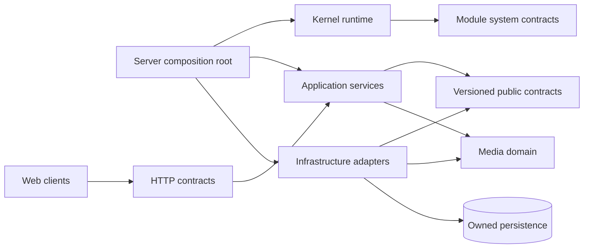

# Architecture

## Platform and domain suites (Phase 12)

`Hispania.Platform.Contracts` contains cross-domain mechanisms and public abstractions. It must not reference Media or Inventory. `Hispania.Runtime` implements generic runtime facilities; domain behavior remains in its owning suite. Media is currently expressed through `core/domain`, `contracts/{library,metadata,playback}`, and their application services and adapters. See [ADR-0030](adr/ADR-0030-platform-generalization-and-domain-suites.md) for dependency boundaries and validation.

The first platform contracts cover versioned in-process events, audit records, opaque asset references, and Identity. Identity owns users, credentials, and sessions in a dedicated SQLite store; it uses PBKDF2 password hashes and hashed opaque session tokens. Its HTTP routes are a Phase 13.1 demonstration and coexist with the legacy admin bearer. General authorization is deferred to Phase 13.2; see [ADR-0031](adr/ADR-0031-platform-identity-foundation.md). The event bus dispatches sequentially, isolates individual handler failures, propagates caller cancellation, and exposes an injectable metrics hook. It is local and non-durable. Asset interfaces do not reveal physical paths; storage and authorization implementations are still host responsibilities.

Inventory is composed as a second suite: `contracts/inventory` -> `application/inventory` -> Inventory-owned `infrastructure/persistence/inventory-sqlite`. Its SQLite file/tables are separate from Library, and only Inventory tables have relational constraints. Inventory keeps opaque Platform `AssetId` references and publishes versioned events; the server composes queries and Assets for `/erp/inventory`. This is an ERP foundation and second-domain proof, not a complete ERP. `Hispania.Platform.slnf` builds Platform contracts, runtime, generic WorkerAgent, and Platform persistence without Media, Playback, FFmpeg, or Inventory implementation.

The Inventory page is registered alongside Media through the Web Shell route/navigation registry and is reached at `/erp/inventory`. Inventory writes use the configured `Modules:AdminToken` bearer filter; reads are public. Identity now provides Platform users and sessions, but does not yet authorize domain operations or replace this legacy bearer; that is Phase 13.2 work. The server is the composition root for Inventory; dynamic module registration is future work.

Media remains the suite owning Library, Metadata, Search/catalog, Playback, Streaming, and Transcoding capabilities. The current names are distributed across the existing project tree; this phase formalizes ownership before moving source folders.

## 1. Architectural Style

Inicialmente se utilizará un **modular monolith**.

El sistema corre principalmente como un único proceso, pero cada subsistema está aislado por contratos.

Microservicios no son el punto de partida.

La arquitectura debe permitir extraer algunos módulos a procesos o nodos separados en el futuro sin reescribir el dominio.

## 2. High-level view

```text
                    Clients
          Web / TV / Android / Others
                       |
                  Public API
                       |
                  Application Host
                       |
                    Kernel
                       |
       +---------------+----------------+
       |               |                |
     Library         Playback          Users
       |               |                |
     modules         modules          modules
       |               |
  Metadata/Search   Media Engine
                       |
                 FFmpeg module
```

## 3. Kernel Responsibilities

El kernel gestiona:

- bootstrapping;
- module discovery;
- dependency resolution;
- module lifecycle;
- configuration;
- events;
- permissions;
- health;
- contracts;
- compatibility;
- observability hooks.

El kernel no implementa funcionalidades de dominio multimedia.

### Phase 1 module infrastructure

The initial module infrastructure separates the module catalogue, operational lifecycle and contract resolution:

- `IModuleRegistry` registers modules and exposes the catalogue;
- `IModuleRuntime` owns lifecycle state and module health;
- `IModuleResolver` resolves a selected module through a requested contract.

The application host is the composition root and may reference static module implementations only to register them. Consumers depend on contracts, never on concrete module classes. Host health remains distinct from temporary module diagnostics.

`ModuleDescriptor` is part of `Hispania.ModuleSystem.Contracts`: it defines the public identity of a module (`Id`, `Name`, `Version`) alongside `IModule`, without requiring module implementers to reference the kernel.

## 4. Dependency Rule

### Implemented dependency graph (2026-09-26)



Las aplicaciones de Library, Metadata y Playback no referencian adaptadores concretos. El composition root sí los conoce para ensamblar el proceso. FFprobe consume el contrato Media-owned de acceso a contenido; el proveedor de fuentes interpreta locators. EFCore contiene stores/modelo relacionales compartidos, mientras los proveedores y migraciones están en adaptadores separados.

La resolución por capacidad usa `(contractId, contractVersion)` y requiere seleccionar un `moduleId` si hay más de un proveedor. No hay elección implícita por orden de registro. El host selecciona `Modules:PlaybackPlanner`; el contrato funcional queda en `Hispania.Playback.Contracts`. Las versiones se comparan por igualdad exacta, sin negociación de rangos.

El runtime incorpora `VariantExperimentRouter<T>` (ADR-0028), conectado al endpoint de reproducción y a la API administrativa autenticada. Identifica variantes por módulo, versión del módulo, contrato y generación; publica snapshots inmutables y distribuye tráfico en puntos básicos. El almacén predeterminado conserva configuración y asignaciones sólo en memoria. Para persistir, configura `PlaybackExperiments:StatePath` (o `PlaybackExperiments__StatePath`) a un archivo local protegido y `PlaybackExperiments:AssignmentSalt` (o `PlaybackExperiments__AssignmentSalt`) con un secreto estable de al menos 32 caracteres; crea el experimento con `"persistent": true`. El JSON guarda configuración/versiones/generaciones, variantes deshabilitadas, hashes SHA-256 salados de asignaciones y expiraciones a 30 días, nunca IDs de sesión o usuario en claro. El fingerprint de la sal impide reanudar si se elimina o cambia. El archivo se reemplaza atómicamente para un único host; varias réplicas requieren una implementación coordinada de `IPlaybackExperimentStore`.

Al reiniciar, el host valida contra el supervisor cada proveedor: debe estar registrado, activo, sano, autorizado y conservar exactamente la versión de módulo, versión de contrato, capacidad y declaración experimental persistidas. No carga ni autoriza extensiones automáticamente. Una variante ausente puede seguir `RedistributeToHealthy`: sus asignaciones se eliminan y las restantes se renormalizan; con una sola variante superviviente el experimento pasa a Manual. Una variante incompatible o no autorizada bloquea la reanudación completa; la configuración queda en disco y la API informa `recovery.state = NotResumed` para que un administrador corrija o reconfigure. `Fail` tampoco permite la degradación automática por una variante ausente. Las operaciones en vuelo al morir el proceso se interrumpen y no se reproducen; las métricas en memoria no sobreviven al reinicio. Un rollback previo a la reanudación solo existe en memoria; tras reiniciar se requiere una nueva configuración administrativa para fijar otra versión.

Los dos Playback Planner actuales declaran compatibilidad manual, A/B y shadow. La ruta admin `/internal/admin/modules/playback-experiments` exige el bearer ya configurado para administración. El POST de configuración admite `"persistent": true`; consultar estado con GET, métricas con GET `/{id}/metrics`, suspender una variante con POST `/{id}/variants/{moduleId}/suspend`, suspender el experimento con POST `/{id}/suspend`, recuperar la configuración previa con POST `/{id}/rollback`, retirar del tráfico nuevo con POST `/{id}/variants/{moduleId}/retire`, y finalizar/drenar/exportar con POST `/{id}/finish`. Shadow devuelve exclusivamente el resultado activo y sólo se admite si los módulos declaran el límite público de lectura `IMediaCatalogReader`; no replica transcodificaciones ni reproducción. Esa declaración limita dependencias disponibles, pero código nativo de confianza aún puede producir efectos ocultos. La retirada conserva el módulo cargado para completar llamadas capturadas y otras capacidades. El contrato síncrono del planner no acepta cancelación; timeouts/cancelaciones se registran si los proveedores los lanzan, y la observación shadow vence a 100 ms sin bloquear la respuesta primaria.

```text
HTTP/cliente -> contrato API -> application -> contrato de módulo -> implementación seleccionada
                                       |                                  |
                                       +-> read/write contract -> persistence owner
Eventos (futuro): hechos de estado; solicitudes síncronas conservan request/response.
```

El ciclo de vida de módulos nativos registrados está ligado al proceso. El runtime no descarga assemblies, no cambia DI después del arranque, y no implementa activar/desactivar en caliente. La selección manual tiene efecto al iniciar/reiniciar el host. Separar un módulo a proceso requiere un adaptador IPC del mismo contrato.

### Fase 11 — trabajo y transcoding distribuidos

El coordinador único expone rutas HTTPS/mTLS separadas del IPC local. Las identidades de nodo y allowlists de capacidad se provisionan por la API administrativa autenticada; el certificado cliente se autoriza por fingerprint SHA-256. El agente genérico negocia la versión, anuncia capacidades y ejecuta extensiones mediante el catálogo/host OutOfProcess. La persistencia SQLite usa transacciones y lock exclusivo de instancia. Tras reiniciar se invalida la conexión, se recuperan generaciones, se reintenta sólo trabajo retry-safe sin efectos externos y se marca incierto el resto.

Playback conserva `ICompatibleMediaTranscoderV1` y handles opacos. Con `DistributedWorkers:Transcoding:Mode=RemotePreferred`, el transcoder busca capacidad FFmpeg exacta y publica la solicitud genérica; el handler del agente reutiliza `Hispania.FFmpeg.Worker`. Un broker separado por job limita el acceso a fuente mediante bloques seekable y publica el resultado sólo tras límite de tamaño e integridad SHA-256. Playback valida el MP4 y lo importa a su cache opaca usual. `Local` es el default; `RemotePreferred` cae a local cuando el trabajador falla o no toma el lease en 10 segundos; `RemoteOnly` responde no disponible si no consigue resultado remoto. La cancelación invalida el lease y se propaga en el heartbeat siguiente; las generaciones obsoletas no pueden completar/publicar.

La prueba local levanta el agente como proceso independiente, hace el transcoding real vía el endpoint Playback, valida con ffprobe, cancela otro trabajo real de FFmpeg durante una subida bloqueada de resultado y mata el agente durante una lectura de medios bloqueada para comprobar fallback local y fencing. No equivale a una prueba en segundo equipo físico. Linux Actions y una red real quedan por verificar. No se promete exactly-once. Ver ADR-0029.

Las pruebas deterministas del broker cancelan una subida, comprueban que no quedan archivos `.partial`, rechazan una lease obsoleta justo antes del rename de publicación y eliminan un artefacto si SQLite rechaza la finalización. La recuperación de SQLite conserva los estados `Pending` y `Uncertain` según la política y rechaza una segunda instancia. Al iniciar, el coordinator obtiene primero el lock SQLite y sólo entonces limpia parciales abandonados; el agente obtiene un lock exclusivo de su caché antes de retirar temporales dejados por un proceso anterior. Si el coordinator se cae después del rename atómico pero antes de guardar `Completed`, puede quedar un archivo sin referencia hasta su caducidad de 24 horas; Playback no recibe su handle y el job recuperado usa una nueva generación.

No se ha terminado una prueba de matar el worker específicamente durante encoding. La prueba de subida cancela el trabajo mientras el agente remoto está enviando el resultado y comprueba limpieza; el test de lectura fuente mata el proceso agente. El aislamiento de proceso y los límites FFmpeg contienen fallos accidentales y recursos configurados; no son una sandbox para código hostil. TLS/mTLS y fingerprints autentican extremos provisionados, pero no aportan exactly-once ni protegen contra el compromiso de una máquina autorizada.

### Ownership actual de datos

- **Library** posee imports, Work/MediaEntity/Timeline/Asset/Representation/MediaSource y la reconciliación del catálogo.
- **Metadata Application** posee la política de aplicación/selección efectiva; **metadata persistence** conserva assertions, procedencia, referencias artwork, locks y estado de refresh.
- **SQLite adapter** posee esquema SQLite, migraciones y formatos físicos. Los consumidores leen/escriben mediante contratos de aplicación, no tablas.
- **Playback** lee el catálogo mediante `IMediaCatalogReader`; no persiste ni reconcilia biblioteca.

El módulo FFprobe consume `IMediaSourceContentAccessV1` (contrato propiedad del dominio Media, versión 1.0). No recibe paths ni depende del scanner/local filesystem. El proveedor de fuentes es dueño de la interpretación del locator y del control de acceso/contención. El adaptador local conserva el rechazo de paths fuera de root y reparse points.

Playback posee `ICompatibleMediaTranscoderV1` y `ITranscodedContentStore`; FFmpeg los implementa en `infrastructure/transcoding-ffmpeg`. Consume la lectura de fuentes y `IMediaCatalogReader`; devuelve un handle opaco, MIME y longitud, nunca una ruta local. El endpoint entrega bytes y rangos mediante el almacén. FFmpeg corre en `Hispania.FFmpeg.Worker`, un proceso por trabajo, con contrato IPC versionado `hispania.transcoding.ffmpeg.worker@1`: JSON de petición/respuesta y bytes fuente por stdin. El host aplica timeout de cuatro horas, cancelación de árbol de procesos y un reintento con nueva lectura; el worker publica el resultado atómicamente en una caché compartida.

EFCore no referencia un proveedor concreto ni sus excepciones. `Persistence:Provider` selecciona SQLite (default) o PostgreSQL al arrancar. SQLite conserva migraciones y UUID BLOB; PostgreSQL tiene migración propia y UUID nativo. Los adapters clasifican conflictos únicos por proveedor. Timestamps (ticks/offset) y decimales (texto invariante) conservan la representación lógica. Las pruebas generan modelo y SQL PostgreSQL sin servicio; la prueba de migración/recuperación real requiere `HISPANIA_POSTGRES_TEST_CONNECTION`. No se ha copiado, migrado ni alterado el catálogo SQLite.

Los records SQL son internos a la implementación salvo accesos de test por `InternalsVisibleTo`. Las migraciones corren al iniciar mediante el initializer del proveedor seleccionado; no hay downgrade automático. SQLite normaliza su historia legacy dentro de su adapter. Rollback operacional: detener el host, restaurar copia de seguridad consistente y volver a la versión anterior. No ejecutar rollback de esquema a mano sobre biblioteca de usuario. PostgreSQL se prueba en CI con PostgreSQL 16 real; la prueba obliga a configurar el connection string y crea/borra sólo un schema temporal dedicado.

### Isolation levels

- **Lógico:** contratos aíslan ownership y operaciones. No restringen a código nativo confiable que comparte proceso.
- **Proceso:** worker FFmpeg y FFmpeg se ejecutan fuera del host HTTP; una falla de trabajo puede cancelarse y recuperarse lanzando otro worker.
- **Recursos:** `Playback:Worker` configura concurrencia, timeout, memoria, CPU y límites de salida. Windows aplica Job Object (memoria, CPU rate/tiempo y kill-on-close); Linux aplica `prlimit` (address-space, CPU-tiempo y file-size) y límite de heap del GC. Son límites operativos, no sandbox de seguridad. El techo temporal limita tamaño de salida por job y la poda de caché es best-effort; no hay cuota del volumen/caché agregado. El worker comparte identidad, entorno y caché, sin ACL dedicada.

El worker transporta el `Activity.TraceId` como correlación opcional V1. Métricas registran intentos, fallos, reintentos, cancelaciones, jobs activos, duración, tamaño y recursos observados del proceso. `/healthz` representa salud del servidor y no se degrada por el módulo opcional; `/internal/capabilities/transcoding/health` expone el estado de esa capacidad. Las pruebas de recuperación simulan crash, timeout, cancelación y fallo de publicación y verifican limpieza/reintento; FFmpeg real verifica publicación/cache en Windows. La implementación Linux de `prlimit` requiere validación de ejecución en CI/plataformas Linux antes de considerarla garantía de despliegue.

Trusted .NET extensions use a versioned local package, inert validation/install, host allowlist and collectible `AssemblyLoadContext` with `AssemblyDependencyResolver`. The context resolves public contract assemblies from the host default context by exact identity. Calls through the extension catalog hold leases; deactivation blocks new calls and waits for leases before stopping. Unload unregisters the stopped module, drops runtime references and requests collection; physical uninstall is separate. Version updates preserve the old package and keep the old implementation serving until the candidate starts and passes health. If candidate startup fails, the old implementation stays active. The sample API uses a public greeting contract without a server reference to the implementation. `AssemblyLoadContext` does not sandbox code: trusted extensions inherit server process privileges; effective isolation requires a separate worker process with versioned IPC.

`.hispania` package SHA-256 hashes are integrity checks; canonical RSA-PSS-SHA256 signatures and configured publisher trust/revocation establish the signed publisher identity. Installation accepts local request bytes only, applies size/path/dependency/contract/version checks, does not execute code, and never overwrites an installed version directory. `Modules:TrustedExtensionIds` is the host-controlled module authorization allowlist; publisher trust is a separate decision. Admin routes remain bearer-token protected. CI Linux explicitly runs PostgreSQL and FFmpeg worker/media tests; until an updated workflow run is green, live PostgreSQL and Linux `prlimit` remain operationally unverified.

### Web client variants

Vite produce dos artefactos independientes con entrypoints y hojas de tema separados: `apps/web/dist/modern` y `apps/web/dist/classic`. `Web:Build` selecciona uno al arrancar el servidor. Ambos consumen la misma API pública; el build no modifica módulos multimedia. El cambio requiere reiniciar el proceso. Esto no es A/B testing ni despliegue de dos clientes simultáneos.

Las dependencias deben apuntar hacia contratos y dominio estable.

Correcto:

```text
Library
  |
  v
IMetadataProvider
  |
  +--> TMDB module
  +--> Local metadata module
```

Incorrecto:

```text
Library
  |
  v
TmdbMetadataProvider
```

## 5. API Boundary

Los clientes sólo pueden interactuar mediante la API pública.

Controllers deben:

- validar entrada;
- traducir DTOs;
- llamar application services;
- traducir respuesta.

Controllers no deben contener negocio.

## 6. Domain Boundary

El dominio multimedia debe ser independiente de:

- HTTP;
- UI;
- SQL;
- FFmpeg;
- proveedores externos;
- almacenamiento físico.

## 7. Data

Las interfaces de persistencia deben vivir en contratos o dominio de aplicación.

Las implementaciones concretas viven en módulos.

Ejemplos:

- SQLiteRepository
- PostgreSqlRepository

El dominio no conoce SQL.

## 8. Media Engine

Funciones diferentes:

- probing/análisis;
- demux;
- transcode;
- packaging;
- streaming.

No deben mezclarse en una clase gigantesca.

## 9. Playback

Flujo:

```text
PlaybackRequest
       |
ClientCapabilities
       |
AvailableMediaSources
       |
PlaybackPlanner
       |
PlaybackPlan
       |
PlaybackExecutor
```

El planner y el executor son piezas separadas.

## 10. Event Architecture

Eventos de dominio/aplicación sugeridos:

- MediaAdded
- MediaRemoved
- MediaUpdated
- LibraryScanStarted
- LibraryScanCompleted
- MetadataUpdated
- PlaybackStarted
- PlaybackStopped
- UserCreated
- ModuleLoaded
- ModuleFailed
- PluginInstalled

Inicialmente pueden ser in-process.

En el futuro puede existir un bridge hacia NATS u otro bus externo.

## 11. Distributed Evolution

La arquitectura debe permitir:

```text
Main Server
   |
 Event/Command transport
   |
   +-- scanner node
   +-- metadata node
   +-- transcode GPU node
   +-- search node
```

pero nunca se debe diseñar el MVP como sistema distribuido.

## 12. Observability

Todos los módulos deben tener:

- logs estructurados;
- metrics;
- traces;
- health;
- version;
- module id.

OpenTelemetry será la abstracción preferida.

### Fase 11: trabajadores distribuidos

El coordinador único del servidor ofrece HTTPS con certificado de cliente y rutas separadas `/internal/worker/v1`; el agente no recibe acceso a rutas administrativas ni al IPC local. La identidad del nodo se autoriza fuera de banda mediante SHA-256 del certificado, con allowlist explícita de capacidades. El coordinador persiste trabajadores y trabajos en SQLite transaccional, y un lock exclusivo impide que dos procesos compartan el estado. Tras reiniciar, invalida los leases en curso; solo reencola trabajos declarados repetibles y sin efectos externos, y los demás quedan `Uncertain`. Las generaciones conservadas rechazan resultados antiguos.

El agente genérico ejecuta capacidades mediante el catálogo de extensiones y el host OutOfProcess existente. Su composición opcional incluye el handler versionado FFmpeg, que llama al mismo `Hispania.FFmpeg.Worker` local instalado en el nodo. El worker recibe bloques autorizados por el broker, aplica límites de procesos/CPU/memoria/tiempo, sube un resultado con SHA-256 y responde bajo fencing. Playback obtiene el resultado por su contrato existente y cachea bajo un handle opaco; consumidores no conocen el host remoto. La integración comprobada ejecuta un agente independiente en un segundo proceso del mismo equipo y verifica la salida con ffprobe, además de fallback local tras cortar al agente durante la transferencia. La prueba de un segundo equipo físico sigue pendiente. Ver ADR-0029.

## 13. Error Policy

Errores deben ser explícitos y clasificables:

- validation;
- unavailable dependency;
- timeout;
- permission denied;
- unsupported media;
- malformed media;
- provider failure;
- conflict;
- cancellation.

No usar excepciones genéricas para control de flujo normal.

## 14. Module supervision and controlled replacement (Phase 5)

`ModuleRuntime` supervises the statically registered module set and reports `Registered`, `Starting`, `Running`, `Degraded`, `Draining`, `Stopping`, `Stopped` and `Failed`. Descriptors expose implementation version, versioned provided/required capabilities and explicit module dependencies. Startup validates dependency versions, required capability availability and dependency cycles. Transitions emit `StateChanged` and the `hispania.modules.transitions` metric. Optional capability failure is distinct from server `/healthz`.

The first in-process replacement is limited to the pure `hispania.playback.planner@1.0` capability. The replacement is initialized and health checked before routing changes. Each synchronous planning operation leases one immutable planner generation; replacement sends new operations to the new generation, while the previous generation stops accepting leases and drains existing calls before its module is stopped. A failed planner call is propagated once (it is never replayed); the host blocks new planner calls during recovery, restarts and checks the previous implementation, restores its route, then retires the failed generation. Activation/drain errors attempt to restore the previous route. Admin access is an internal bearer-token protected endpoint, disabled when no token is configured.

This hot-swap path is **registry substitution inside one process**. Both implementations and their assemblies remain loaded, and deployment files are untouched. Assembly unloading and physical binary replacement are not implemented. It remains distinct from the generic A/B routing foundation (ADR-0028), which is not yet integrated with Playback Planner or supervisor lifecycle. Database replacement, database migrations during traffic, and effectful capabilities remain ineligible. Module lifecycle and hot-swap metrics are in-process counters; transition events are available to host consumers.

Historical validation note: the paragraph above was replaced by the final Phase 12 CI evidence. On current `main`, SHA `2e16b039d0fb8a3223366f7af478353b68886af1`, [Validation #36625775324](https://github.com/joaquimcastilla/hispania/actions/runs/36625775324) passed on Linux and Windows. PostgreSQL-live passed 1/1 on Linux; Platform-only, full builds/suites, Linux resource-control worker paths, and server restart/recovery checks passed in their configured jobs. See the README for the result summary and ADR-0030 for Phase 12 closure evidence. This does not mean every configured resource ceiling has been stress-tested to exhaustion.

## 15. Manifest discovery and installable extensions (Phase 7)

The host scans `extensions/**/module.json` as metadata only. Package versions live side by side under `extensions/<id>/<version>`. The installer validates the package version, compatibility bounds, dependency/contract requirements, payload paths, complete file list and SHA-256 digests before atomically publishing inert files. It does not load assemblies. Activation requires an ID from the host allowlist, loads only its declared entry type, verifies the runtime descriptor against the manifest, shares public contracts with the host, and supervises the module lifecycle. Admin API operations use the existing bearer-token filter. `Installed`, allowlisted/trusted, `Loaded` and lifecycle state are reported separately.

Extension calls routed through `ModuleExtensionCatalog.Acquire<TContract>` hold a lease. Deactivation prevents additional leases and drains existing work. Unload then unregisters the stopped module and releases the collectible load context; uninstall deletes package files only after unload. Update keeps the prior version installed and the prior implementation serving while the candidate is started and health-checked; a failed candidate leaves the prior implementation active. Generic update does not replay leased business operations. Lifecycle callbacks must remain safe to retry. Static built-in factories remain supported.

All loaded native code shares the server's process privileges. Package SHA-256 digests do not authenticate a publisher, and `AssemblyLoadContext` is not a sandbox. Do not activate a package ID that the operator has not explicitly allowlisted and trusted. Code requiring effective isolation needs a separate worker process and versioned IPC. No Internet package source or automatic download is implemented.

### Phase 8: package provenance and process extensions

Module manifests select `dotnet-inprocess-trusted` or `dotnet-outofprocess` explicitly. In-process .NET modules use collectible `AssemblyLoadContext`; external modules run under `apps/module-host` and consume/serve public versioned contracts through protocol V1 over a current-user local pipe. V1 provides token-authenticated identity/version negotiation, capability discovery, bounded length-prefixed JSON, correlated request/error responses, cancellation, health and graceful stop. The supervisor applies bounded time/concurrency, resource configuration and restart/backoff, degrades a failed implementation independently, and supports explicit version selection/update/rollback.

Package install remains inert; authorization and activation are separate. Signatures cover canonical manifest data and payload digests, but trust roots/revocation must be protected operator policy. Trust API changes are currently in-memory. OOP process separation provides fault containment and configured resource controls, not a security sandbox: child and server still share the OS identity and corresponding filesystem, environment and network privileges. Current-user IPC authentication protects the launch channel from other local users, not from a malicious module process running as the same user. See ADR-0027 and `MODULE_SYSTEM.md` for supported contract limitations and the validation boundary.

Phase 9 local audit additionally records the active generation's signed manifest, rechecks it during reactivation, and stops that exact generation when its publisher is revoked. Unknown publishers cannot update an allowlisted extension. Windows Job Objects set job-time and active-process flags correctly; Windows Actions attached them for generic OOP recovery, and tested the FFmpeg worker. Ubuntu Actions passed PostgreSQL live integration, Linux FFmpeg recovery/media and the generic module suite. Linux generic OOP uses CPU-time `prlimit` and a managed GC heap cap; `RLIMIT_AS` is opt-in because CoreCLR needs a larger address-space reservation, so an OS memory quota via cgroups/systemd remains pending. Installed versions persist, but extension boot autostart, transaction-journal recovery for interrupted install/uninstall, hard cache-volume quotas, and server-process restart acceptance coverage are not implemented. Neither process mode is a hostile-code sandbox.

## Platform, suites, and ownership

```text
HISPANIA Platform
├── Platform contracts, runtime, event bus, generic workers, trust and module host
├── Media suite (Library, Metadata, Playback, Streaming, Transcoding)
├── Inventory bounded context (its own contracts, application and SQLite database)
└── Web Shell (shared layout/navigation with Media UI and Inventory UI)
```

Inventory stores opaque asset references only. `apps/server` composes Inventory, Platform Assets, and the optional Media video capability. Platform stores asset metadata in its own SQLite database and bytes under a separate content root; Audit has a separate append-only SQLite database. Media library data remains under its existing persistence provider. The solution filter builds Platform contracts/runtime/host, generic WorkerAgent and Platform persistence without Inventory or Media implementations.

```text
Inventory item → AssetRef → Platform Assets → (if video/mp4 and public) Media asset stream capability
```

Server and WorkerAgent are composition roots. They assemble public contracts with concrete adapters and providers; domain projects may reference Platform contracts but cannot reference peer-domain implementations. FFmpeg is discovered by WorkerAgent through the generic Runtime provider interface and configured provider assembly list.

### Phase 13.2: Platform authorization and Web authentication

Platform Authorization owns versioned role/access contracts, policy and SQLite persistence alongside Identity in `identity.sqlite`. Effective permissions are resolved from a user's roles on every protected request; missing grants deny, and disabled users are denied regardless of session validity. The reserved `platform.admin` permission grants `platform.*` only. Media and Inventory do not reference the authorization implementation and their complete authorization migration remains deferred to Phase 13.3. See ADR-0032 for bootstrap and compatibility details.

The server's reusable permission endpoint filter validates the opaque session through Identity before checking the current permission grants. It distinguishes unauthenticated 401 from authenticated 403. The bootstrap endpoint is separately guarded by an operator-configured, one-time secret. The legacy admin bearer remains accepted only on endpoints using the compatibility filter, with a warning, until a later removal phase.

The shared Modern/Classic Web Shell keeps its tab session in `sessionStorage`, reloads current user/effective permissions through `/api/identity/me`, and revokes on logout. Protected user/role routes gate navigation and direct page rendering while their server endpoints enforce permissions independently. `sessionStorage` is not protected from same-origin script execution; cookie-based auth would require an explicit CSRF/origin design.
